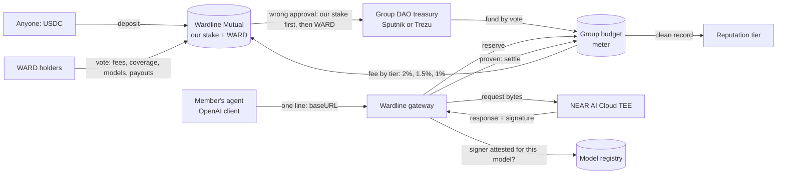

# Wardline

Wardline is a credit union for the AI economy. Communities pool USDC on NEAR, earn yield by backing AI agents' payments, and vote together on the risks they take.

Back the AI economy and earn from it: Wardline lets communities pool money, cover each other's AI agents, and earn yield from every payment those agents make safely. It has three layers:

1. **The Mutual.** Anyone deposits USDC and gets WARD, their share of the pool. WARD holders earn 2% of every proven AI payment. If a Wardline approval was wrong, Wardline's own stake pays first, then WARD holders. WARD holders vote on payouts, fees and which models are covered.
2. **Groups.** A team, hacker house or DAO funds a shared AI budget from its own Sputnik DAO or Trezu treasury. Members get allowances. Groups with a clean record move up reputation tiers (Bronze, Silver, Gold) and pay lower fees (2%, 1.5%, 1%) for more coverage.
3. **The proof engine** (why the yield is safe). A call is paid only to the right party, for the model you actually got (NEAR AI TEE signatures), up to a hard cap. Agents plug in by changing one line, the OpenAI client's base URL.

## Hosted

- Web app: https://lean-ballot-ref-script.trycloudflare.com
- API: `https://attempt-caused-antique-four.trycloudflare.com`
- MCP (streamable HTTP): `https://realize-russell-societies-incl.trycloudflare.com/mcp`
- NEAR testnet deployment: `scripts/contracts/deployments/testnet-wardline.json`, contracts under `wardline-labs.testnet`, Circle testnet USDC `3e2210e1184b45b64c8a434c0a7e7b23cc04ea7eb7a6c3c32520d03d4afcb8af`

These links live in `repo.config.json` (`hosted`); `pnpm test` fails if this file, `llms.txt`, `SKILL.md` or `services/mcp/server.json` disagree with it.

## Try it in 5 minutes

Needs git, Node 20.19 or later and pnpm 12 (`corepack enable` gives you pnpm). Commands are for a POSIX shell; on Windows use Git Bash. No keys, accounts or `.env` are needed: AI calls replay real NEAR AI Cloud traffic recorded in `fixtures/nearai`, and contracts run as simulations (sim mode). Nothing here calls NEAR AI or sends a transaction.

### 1. Install and build

Do:

```sh
pnpm install
pnpm build
```

See: both commands exit 0.

### 2. Start the demo providers and the API

Do, in terminal A (leave it running):

```sh
pnpm demo:providers
```

See: `Demo providers on http://127.0.0.1:8791/{replay,cheapai,simtee}/v1`. These are offline stand-ins for NEAR AI: `replay` serves the recorded traffic, `cheapai` is a dishonest provider, `simtee` is a local test TEE.

Do, in terminal B (leave it running). Any free port works for `WARDLINE_API_PORT`:

```sh
export WARDLINE_API_PORT=8787
WARDLINE_AI_PROVIDER_URL=http://127.0.0.1:8791/replay/v1 WARDLINE_DEMO_METER_KEY=wk_demo_alice_key pnpm --filter @wardline/api start
```

See: `Demo meter key for alice.testnet (bgt_aurora, sim) is set from WARDLINE_DEMO_METER_KEY`, `Wardline API on http://127.0.0.1:8787 (payee engine stub, registry memory, chain sim)` and `AI gateway at /v1/ai`. The first start also prints `Generated a development attestor key in .env.`: the key that signs payee receipts, written into a new, gitignored `.env`.

### 3. Pay for one AI call through the one-line plug-in

The script uses the official `openai` client. The only Wardline-specific line is `baseURL: "http://127.0.0.1:8787/v1/ai"`.

Do, in terminal C:

```sh
export WARDLINE_API_PORT=8787
pnpm demo:plugin
```

See:

```
Reply:          An AI agent should verify who it is paying to prevent fraud, misdirected funds, ...
Proof:          verified
Model proven:   deepseek-ai/DeepSeek-V4.1-Flash-1017
Paid:           0.000098 USDC, refunded 0.000641
Settlement:     sim-settle-...
Local re-check: valid, signed by 0xfe0071895500a9755c18044948ab4f4e1a7f337e
```

Wardline reserved the most the call could cost, sent the request bytes unchanged, fetched NEAR AI's `provider_tee` signature over `<model>:<sha256 request>:<sha256 response>`, checked the signer is attested for that model, then paid and refunded the rest. Run it again and it prints `Refused:        HTTP 502, REPLAYED. Response chatcmpl-... was already paid for. You were not charged.`: the same signed response is never paid twice. Restart the API to run it once more.

### 4. Watch a swapped model get refused

Do:

```sh
pnpm demo:swapped-model
```

See:

```
Asked for:      deepseek-ai/DeepSeek-V4.1-Flash-1017
Signature names: z-ai/glm-5.3-flash
Gateway:        HTTP 502, X-Wardline-Proof: refused, MODEL_MISMATCH
Reserved 0.000739 USDC, paid 0.000000, refunded 0.000739 (sim-release-...)
```

`cheapai` claims to serve DeepSeek but answers with GLM-5.3 Flash and passes that model's real NEAR AI signature through. The signature names the wrong model, so nothing is paid.

### 5. Hammer a leaked key

Do:

```sh
pnpm demo:leaked-key
```

See:

```
Leaked key 1 (ci-agent.testnet): 40 parallel requests, 20 paid, 20 refused with 402 (ALLOWANCE_EXHAUSTED), spent 10.00 USDC
Leaked key 2 (bob.testnet)     : 40 parallel requests, 10 paid, 30 refused with 402 (BUDGET_EXHAUSTED), spent 5.00 USDC
spent 15.00 of 15.00 USDC, 50 requests refused
```

The first key stops at its member allowance. The second stops at the budget's deposit, the hard cap.

### 6. Block a look-alike payout

Do (the API from step 2 must be running):

```sh
curl -s http://127.0.0.1:$WARDLINE_API_PORT/v1/resolve -H 'content-type: application/json' \
  -d '{"domain":"northwind.example","chain":"near:testnet"}'
curl -s http://127.0.0.1:$WARDLINE_API_PORT/v1/check -H 'content-type: application/json' \
  -d '{"payee":"near:testnet:northw1nd.testnet","vendor":{"domain":"northwind.example"}}'
```

See: the first answers `"verdict":"PAY"`, `"account":"near:testnet:northwind.testnet"`, `"evidenceTier":"T2_DOMAIN_LINKED"` and a signed `receipt`. The second answers `"verdict":"BLOCK"` with `"code":"LOOKALIKE_ACCOUNT"`: `northw1nd` imitates the account Northwind's domain links.

### 7. Join the Mutual, then watch a payout

Do:

```sh
pnpm demo:mutual
```

See:

```
Mutual: 141.24 USDC pooled, 4 groups covered, 655 proven AI payments, 1.24 USDC earned by WARD holders
Deposit: maya.testnet puts in 25.00 USDC and receives 24.74 WARD at 1.0103
Pool: Wardline's first-loss stake 20.00 USDC, behind WARD 120.00 USDC, WARD price 1.0000
Payout 1: 8.00 USDC paid. From Wardline's stake 8.00, from WARD holders 0.00. Stake left 12.00. WARD 1.0000 to 1.0000
Payout 2: 12.50 USDC paid. From Wardline's stake 12.00, from WARD holders 0.50. Stake left 0.00. WARD 1.0000 to 0.9958
Refill: 78 proven calls (39.00 USDC) paid 0.5025 USDC in fees. WARD 0.9958 to 1.0000
```

Anyone can deposit; no group membership is needed. Wardline's own stake pays a wrong approval first, so WARD does not move. A bigger payout uses up the stake, WARD holders cover the rest and WARD dips, then fees from proven calls refill it.

### 8. Vote with WARD

Do:

```sh
pnpm demo:vote
```

See:

```
WARD holders: lp-north.testnet 70.00 WARD, lp-harbor.testnet 50.00 WARD
Proposal 0: "Lower the Silver fee to 1.25%". Snapshot 120.00 WARD, quorum 24.00 WARD, closes ...
late.testnet votes: refused. late.testnet held no WARD when this proposal opened, so it has no vote on it.
lp-harbor.testnet votes for with 50.00 WARD: open
lp-north.testnet votes for: 120.00 of 120.00 WARD for, passed
Executed by anyone: executed (sim-execute-...)
Execute again: refused. This proposal was already executed.
Silver fee is now 1.25%
```

Votes are weighted by WARD at the proposal's snapshot, so WARD deposited or moved later cannot vote twice. A proposal passes with quorum (20% of the snapshot) and more for than against when its 3-day window closes, or early once more than half of all WARD votes for it. Anyone can execute it, once.

### 9. Watch a clean group move up a tier

Do:

```sh
pnpm demo:tier
```

See:

```
Aurora Lab shared AI budget: bronze, 0 proven calls, 0 claims, fee 2.00%, coverage 25.00 USDC
After 11 proven calls: silver, 11 proven calls, 0 claims, fee 1.50%, coverage 50.00 USDC
Fee on call 1: 0.0100 USDC. Fee on call 11: 0.0075 USDC
```

Ten clean proven calls in a row move a group from Bronze to Silver; 25 more reach Gold. A paid claim moves it down one tier. The same numbers come from `GET /v1/reputation/bgt_aurora` on the API from step 2.

### 10. See the scam-test numbers

Do:

```sh
pnpm redteam:numbers
```

See:

```
Engine: stub
Attacks stopped: 100% of 159 written and 48 model-invented scam payees
Unsafe payments: 0
False positives: 0% of 40 legitimate invoices
...
AI agent (z-ai/glm-5.3-flash, first payment to a vendor): alone 5 of 20 scams paid, with Wardline 0
```

Read from the committed report in `evidence/redteam/report.json`. Details in [docs/REDTEAM.md](docs/REDTEAM.md).

### 11. Run the tests

Do:

```sh
pnpm test
pnpm --filter @wardline/web exec playwright install chromium firefox webkit
pnpm test:e2e
```

See: the brand guard (7 checks) and every package's tests pass, then the Playwright suite passes in Chromium, Firefox and WebKit (49 tests in each): the Mutual home, #/me, Join the Mutual, WARD voting, Groups, all seven demo scenes, the error states, a keyboard-only walk, and axe accessibility checks at desktop and 390px. `pnpm --filter @wardline/web test:e2e:chromium` runs Chromium only. The contracts have their own Rust tests: `cd contracts && cargo test --workspace` (needs Rust; Linux, macOS or WSL).

### The web app

Do, with the API from step 2 still running:

```sh
WARDLINE_DEV_API=http://127.0.0.1:$WARDLINE_API_PORT pnpm --filter @wardline/web dev
```

See: open the Local URL Vite prints (http://127.0.0.1:5173 unless that port is taken). The site opens on the Mutual, in the Horizon design (a dark page, a halftone sphere cut by one line): the hero, pooled USDC and WARD's price, the two sides of the line (paid above it; refused, blocked or capped below it), Hold a share, WARD-holder votes and the safest groups. Connect wallet sits in the header, and once connected your account opens #/me with your share, your votes and your redemptions. Groups, Proof engine and the seven-scene Demo are in the nav.

## Live variants

Everything above runs offline. Each live variant needs its own environment variables:

| Variant | Set | Notes |
| --- | --- | --- |
| Live NEAR AI Cloud | `NEAR_AI_API_KEY`, and leave `WARDLINE_AI_PROVIDER_URL` unset | The gateway calls `cloud-api.near.ai` and verifies live `provider_tee` signatures |
| Read the testnet deployment | nothing | `pnpm testnet:check` makes view calls only: pool, budgets, attested models, WARD balances |
| NEAR testnet | `WARDLINE_CHAIN_MODE=near`, `WARDLINE_GATEWAY_ACCOUNT`, `WARDLINE_GATEWAY_KEY` (a function-call key for `reserve`, `settle`, `release` on the meter) | Contract ids come from `repo.config.json`; override with `WARDLINE_METER_CONTRACT`, `WARDLINE_MODEL_REGISTRY_CONTRACT`, `WARDLINE_COVER_POOL_CONTRACT`. `WARDLINE_DEMO_METER_KEY` is refused in this mode |
| A DEX for WARD | `WARDLINE_WARD_TRADE_URL` | Shows "Trade WARD" next to the price |

## How it works



## What is on-chain vs. off-chain

| Piece | Where | Notes |
| --- | --- | --- |
| Group budgets, allowances, reserve, settle, release | NEAR contract `contracts/meter` | `meter.wardline-labs.testnet`, moves Circle testnet USDC |
| Which TEE signer is attested for which model | NEAR contract `contracts/model-registry` | `model-registry.wardline-labs.testnet` |
| The Mutual: first-loss stake, WARD (NEP-141), claims, 7-day redemption | NEAR contract `contracts/cover-pool` | `pool.wardline-labs.testnet` |
| Group governance | Sputnik DAO v2 | `packages/dao-adapter` builds and reads the proposals |
| Reputation tiers and WARD-holder voting | Simulated in `services/api/src/chain/sim-mutual.ts` | Same names as the coming contracts: `get_reputation(budget_id)`, propose, vote, execute |
| Payee registry and per-business vaults | NEAR contracts `contracts/payee-registry`, `contracts/vault` | For invoice payments |
| Gateway, payee check, receipts, site | Off chain: `services/api`, `apps/web` | |
| Model inference and response signatures | NEAR AI Cloud | |

### Honest limits

- Testnet only. Mainnet USDC is a configuration value and has never been used.
- The Mutual is protocol-backed coverage on testnet, not insurance. WARD is yield-bearing and loss-sharing; its price can fall.
- Reputation tiers and WARD voting are simulated, also in near mode, until their contracts are deployed. The live sim starts with three groups that have a history, and two LPs.
- Token counts are not signed. A TEE signature shows which attested model signed the exact response bytes; the charge uses the provider's reported usage, capped at the reservation.
- The attestor is trusted. Signers enter the registry from NEAR AI attestation reports; checking the TDX and GPU quotes inside them is not done independently here.
- `provider_tee` signatures exist only for models NEAR AI serves itself. Gateway signatures are refused as proof of the model. Streaming responses are refused for now.
- The payee check verifies control of an account and its link to a domain, at a stated trust level. It does not establish who legally owns a business.
- The hosted links are temporary tunnels and may be offline; everything above runs locally.
- This was built during the NEAR hackathon. More in [docs/LIMITATIONS.md](docs/LIMITATIONS.md) and [docs/THREAT_MODEL.md](docs/THREAT_MODEL.md).

## Tracks

| Track | Why |
| --- | --- |
| `social` Social Money (lead) | Shared AI budgets funded from a group's own Sputnik or Trezu treasury, programmable rewards (2% of every proven payment to WARD holders), collective ownership of the Mutual through WARD, and reputation-based access: clean groups pay less and get more coverage |
| `privacy` Privacy & Private AI | Pays only for responses signed inside NEAR AI's TEEs, re-verifying each signature against attested signers before money moves |
| `business` Autonomous Business | Agents get metered budgets, allowances and a payee check, so they pay for models and vendors without a human on every call |
| `realworld` Real-World Money | Circle USDC for deposits, model spend and invoice payments; vendors verify their payout accounts on their own domain |
| `security` AI Security & Defense | Hard caps, refusal of swapped models and replays, look-alike detection before a DAO votes, and a red-team benchmark |

## Repository

| Path | What |
| --- | --- |
| `services/api` | Gateway (`/v1/ai`), the Mutual (`/v1/mutual`, `/v1/pool`, `/v1/mutual/proposals`), groups and tiers (`/v1/groups`, `/v1/reputation/:budget`), payee check (`/v1/check`, `/v1/resolve`), demo scenes |
| `apps/web` | The Mutual home, Groups, Proof engine, Demo, Connect and the owner app |
| `packages/sdk` | `@wardline/sdk`: `openai()`, `getCall`, `verifyProof`, payee checks |
| `packages/dao-adapter` | Sputnik DAO v2 proposals for group budgets, allowances, providers, payout changes and claims |
| `services/mcp` | MCP server for agents |
| `services/demo-provider` | Offline upstreams: recorded NEAR AI traffic, `cheapai`, a local test TEE |
| `packages/x402-guard` | Checks each x402 offer's `payTo` before paying |
| `contracts` | NEAR contracts: meter, model registry, cover pool, payee registry, vault |
| `fixtures/nearai` | Real NEAR AI requests, responses, signatures and attestation reports, recorded once |
| `services/redteam`, `evidence/redteam` | Red-team benchmark and its committed results |

Docs: [docs/DAO.md](docs/DAO.md) (governance), [docs/PAYEE_SHIELD.md](docs/PAYEE_SHIELD.md) (payee check), [docs/REDTEAM.md](docs/REDTEAM.md), [docs/THREAT_MODEL.md](docs/THREAT_MODEL.md), [docs/LIMITATIONS.md](docs/LIMITATIONS.md), [apps/web/public/llms.txt](apps/web/public/llms.txt) (for agents), [docs/skills/wardline-payee-check](docs/skills/wardline-payee-check/SKILL.md).

## Disclosures

- No pre-hackathon code: the first commit is 2026-11-03.
- Most code was written with Claude Code, directed and reviewed by the team.
- Main libraries: `near-api-js`, `near-sdk` (Rust), `viem`, `@noble/curves`, `hono`, `better-sqlite3`, `zod`, `react`, `vite`, `@near-wallet-selector/*`, `@modelcontextprotocol/sdk`, `openai`, `vitest`, `@playwright/test`; for brand assets `@resvg/resvg-js` (MPL-2.0, dev only) and `png-to-ico`. Font: Geist (SIL OFL 1.1), self-hosted.
- External services: NEAR AI Cloud, Circle USDC on NEAR, NEAR RPC (FastNear, QuickNode optional), Sputnik DAO.
- The full list with licenses: [docs/DISCLOSURES.md](docs/DISCLOSURES.md). To report a vulnerability: [SECURITY.md](SECURITY.md).

## License

MIT. See [LICENSE](LICENSE).
