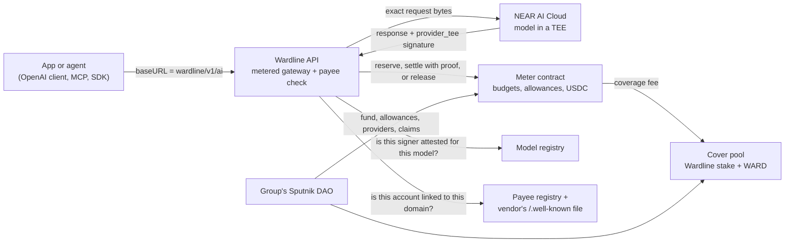

# Wardline

Wardline lets AI agents spend USDC on NEAR only on proof. A model call is paid only when NEAR AI's TEE signature shows the model you asked for signed that exact response, and an invoice is paid only to an account the vendor's own domain links; a deposit caps every budget, a group can govern its budget from a Sputnik DAO, and if a Wardline approval was wrong, Wardline Mutual pays the customer back with Wardline's own stake losing first.

The problem: agents now pay for things. A model provider can quietly serve a cheaper model than the one you pay for, a leaked key can drain a budget, and a "bank details changed" email can send an invoice payment to a look-alike account. Developers plug in by changing one line, the OpenAI client's base URL.

## Try it in 5 minutes

Needs git, Node 20.19 or later and pnpm 12 (`corepack enable` gives you pnpm). Commands are for a POSIX shell; on Windows use Git Bash. No keys, accounts or `.env` are needed: AI calls replay real NEAR AI Cloud traffic recorded in `fixtures/nearai`, and contracts run as simulations (sim mode). Nothing here calls NEAR AI or sends a transaction.

### 1. Install and build

Do:

```sh
pnpm install
pnpm build
```

See: both commands exit 0.

### 2. Start the demo providers and the API

Do, in terminal A (leave it running):

```sh
pnpm demo:providers
```

See: `Demo providers on http://127.0.0.1:8791/{replay,cheapai,simtee}/v1`. These are offline stand-ins for NEAR AI: `replay` serves the recorded traffic, `cheapai` is a dishonest provider, `simtee` is a local test TEE.

Do, in terminal B (leave it running). Any free port works for `WARDLINE_API_PORT`:

```sh
export WARDLINE_API_PORT=8787
WARDLINE_AI_PROVIDER_URL=http://127.0.0.1:8791/replay/v1 WARDLINE_DEMO_METER_KEY=wk_demo_alice_key pnpm --filter @wardline/api start
```

See: `Demo meter key for alice.testnet (bgt_aurora, sim) is set from WARDLINE_DEMO_METER_KEY`, `Wardline API on http://127.0.0.1:8787 (payee engine stub, registry memory, chain sim)` and `AI gateway at /v1/ai`. The first start writes a development receipt-signing key into a new, gitignored `.env`.

### 3. Pay for one AI call through the one-line plug-in

The script uses the official `openai` client. The only Wardline-specific line is `baseURL: "http://127.0.0.1:8787/v1/ai"`.

Do, in terminal C:

```sh
export WARDLINE_API_PORT=8787
pnpm demo:plugin
```

See:

```
Reply:          An AI agent should verify who it is paying to prevent fraud, misdirected funds, ...
Proof:          verified
Model proven:   deepseek-ai/DeepSeek-V4.1-Flash-1017
Paid:           0.000098 USDC, refunded 0.000641
Settlement:     sim-settle-...
Local re-check: valid, signed by 0xfe0071895500a9755c18044948ab4f4e1a7f337e
```

Wardline reserved the most the call could cost, sent the request bytes unchanged, fetched NEAR AI's `provider_tee` signature over `<model>:<sha256 request>:<sha256 response>`, checked the signer is attested for that model, then paid and refunded the rest. Run it again and it fails with `REPLAYED`: the same signed response is never paid twice. Restart the API to run it once more.

### 4. Watch a swapped model get refused

Do:

```sh
pnpm demo:swapped-model
```

See:

```
Asked for:      deepseek-ai/DeepSeek-V4.1-Flash-1017
Signature names: z-ai/glm-5.3-flash
Gateway:        HTTP 502, X-Wardline-Proof: refused, MODEL_MISMATCH
Reserved 0.000739 USDC, paid 0.000000, refunded 0.000739 (sim-release-...)
```

`cheapai` claims to serve DeepSeek but answers with GLM-5.3 Flash and passes that model's real NEAR AI signature through. The signature names the wrong model, so nothing is paid.

### 5. Hammer a leaked key

Do:

```sh
pnpm demo:leaked-key
```

See:

```
Leaked key 1 (ci-agent.testnet): 40 parallel requests, 20 paid, 20 refused with 402 (ALLOWANCE_EXHAUSTED), spent 10.00 USDC
Leaked key 2 (bob.testnet)     : 40 parallel requests, 10 paid, 30 refused with 402 (BUDGET_EXHAUSTED), spent 5.00 USDC
spent 15.00 of 15.00 USDC, 50 requests refused
```

The first key stops at its member allowance. The second stops at the budget's deposit, the hard cap.

### 6. Block a look-alike payout

Do (the API from step 2 must be running):

```sh
curl -s http://127.0.0.1:$WARDLINE_API_PORT/v1/resolve -H 'content-type: application/json' \
  -d '{"domain":"northwind.example","chain":"near:testnet"}'
curl -s http://127.0.0.1:$WARDLINE_API_PORT/v1/check -H 'content-type: application/json' \
  -d '{"payee":"near:testnet:northw1nd.testnet","vendor":{"domain":"northwind.example"}}'
```

See: the first answers `"verdict":"PAY"`, `"account":"near:testnet:northwind.testnet"`, `"evidenceTier":"T2_DOMAIN_LINKED"` and a signed `receipt`. The second answers `"verdict":"BLOCK"` with `"code":"LOOKALIKE_ACCOUNT"`: `northw1nd` imitates the account Northwind's domain linked. T2 means the account signed for itself and the vendor's domain lists it; it does not establish legal ownership.

### 7. Wardline Mutual pays back, Wardline's stake first

Do:

```sh
pnpm demo:mutual
```

See:

```
Pool: Wardline's first-loss stake 20.00 USDC, behind WARD 120.00 USDC, WARD price 1.0000
Payout 1: 8.00 USDC paid. From Wardline's stake 8.00, from WARD holders 0.00. Stake left 12.00. WARD 1.0000 to 1.0000
Payout 2: 18.00 USDC paid. From Wardline's stake 12.00, from WARD holders 6.00. Stake left 0.00. WARD 1.0000 to 0.9500
```

WARD ("Wardline Mutual share") is the pool's yield-bearing, loss-sharing token: its price is pool assets divided by WARD supply, it rises with fees and falls only when a payout goes past Wardline's stake.

### 8. See the red-team numbers

Do:

```sh
pnpm redteam:numbers
```

See: `Attacks stopped: 100% of 159 written and 48 model-invented scam payees`, `Unsafe payments: 0`, `False positives: 0% of 40 legitimate invoices`, and `AI agent (z-ai/glm-5.3-flash, first payment to a vendor): alone 5 of 20 scams paid, with Wardline 0`. Recompute from the committed fixtures with `pnpm --filter @wardline/redteam bench`. Method: [docs/REDTEAM.md](docs/REDTEAM.md).

### 9. Run the tests (optional)

Do:

```sh
pnpm test
pnpm --filter @wardline/web exec playwright install chromium
pnpm --filter @wardline/web test:e2e
```

See: every package passes, then 25 Playwright tests pass. Neither needs the API from step 2.

### Optional: the web app

With the API from step 2 running, do in another terminal:

```sh
export WARDLINE_API_PORT=8787
pnpm --filter @wardline/web dev
```

See: the site at `http://127.0.0.1:5173`. The Demo page runs the five scenes above, the Mutual page shows WARD and takes a wallet-signed deposit, and Try it runs the payee check. Owner pages (`#/app`) need a NEAR wallet sign-in; for a local look, start the API with `WARDLINE_OWNER_AUTH=off` added.

### Live variants

Each step above has a live form. Put values in `.env` (start from `.env.example`); never commit it.

| To use | Set | Notes |
| --- | --- | --- |
| Live NEAR AI Cloud | `NEAR_AI_API_KEY`, and leave out `WARDLINE_AI_PROVIDER_URL` | Paid calls to NEAR AI. Routed models are in `services/api/src/meter/models.ts` |
| Contracts on NEAR testnet | `WARDLINE_CHAIN_MODE=near`, `WARDLINE_METER_CONTRACT`, `WARDLINE_MODEL_REGISTRY_CONTRACT`, `WARDLINE_COVER_POOL_CONTRACT`, `WARDLINE_GATEWAY_ACCOUNT`, `WARDLINE_GATEWAY_KEY`, `NEAR_RPC_URL` | The meter, model registry and cover pool contracts are written and sandbox-tested, not yet deployed. See Limits |
| Circle USDC | `WARDLINE_USDC_ACCOUNT` | Testnet `3e2210e1184b45b64c8a434c0a7e7b23cc04ea7eb7a6c3c32520d03d4afcb8af` by default |
| A group's real DAO | `WARDLINE_DAO_ACCOUNT` | Any Sputnik DAO v2 or Trezu treasury |
| Owner sign-in | `WARDLINE_OWNER_ACCOUNTS`, `WARDLINE_APPROVER_ACCOUNTS` | NEAR accounts allowed into the dashboard |

## How it works



Per AI call: resolve the meter key's budget and member, reserve the most the call can cost, send the request bytes serialized once, hash the exact response bytes, fetch the `provider_tee` signature (bounded retry), verify it locally (EIP-191 signer, signed text, signer attested for that model), then settle with the proof or release the whole reservation. There is no path that pays without a verified proof. The meter re-verifies the proof itself before paying.

### On-chain and off-chain

| Piece | Where | Status |
| --- | --- | --- |
| Meter: budgets, allowances, reserve, settle with proof, release | NEAR contract `contracts/meter` (EIP-191 `ecrecover` on chain) | Written and sandbox-tested; not yet on testnet. The API runs a simulation with the same rules |
| Model registry: which TEE signer is attested for which model | NEAR contract `contracts/model-registry` | Written and sandbox-tested; not yet on testnet |
| Wardline Mutual: junior stake, WARD, claims | NEAR contract `contracts/cover-pool` | Written and sandbox-tested; WARD and redemption are simulated in the API until the contract has them |
| Payee registry and per-business vaults | NEAR contracts `contracts/payee-registry`, `contracts/vault` | Vaults deployed on testnet under `redline-labs.testnet` (older name, kept because NEAR accounts cannot be renamed) |
| Group governance | Sputnik DAO v2 (existing contracts) | `packages/dao-adapter` builds and reads the proposals |
| Gateway, payee check, signature checks, receipts, dashboard | Off chain: `services/api`, `apps/web` | Runs locally; no hosting in this repository |
| Model inference and response signatures | NEAR AI Cloud | Recorded once; replayed in tests |

### Honest limits

- Token counts are not signed. The TEE signature shows which model's TEE signed the exact response bytes; Wardline charges by the provider's reported usage, capped at the reservation.
- The attestor is trusted today. Signers enter the model registry from NEAR AI attestation reports; checking the TDX and GPU quotes inside those reports is the attestor's job and is not done independently here.
- `provider_tee` signatures exist only for models NEAR AI serves itself. Models listed as "attested 3p" return gateway signatures, which Wardline refuses as proof of the model.
- Wardline Mutual is protocol-backed coverage on testnet, not insurance. WARD is yield-bearing and loss-sharing; its price can fall.
- Testnet only. Mainnet USDC is a configuration value and has not been used. Streaming responses are refused for now.
- The payee check verifies control of an account and its link to a domain, at a stated trust level. It does not establish who legally owns a business.
- More in [docs/LIMITATIONS.md](docs/LIMITATIONS.md) and [docs/THREAT_MODEL.md](docs/THREAT_MODEL.md).

## Tracks

| Track | Why |
| --- | --- |
| `privacy` Privacy & Private AI | Pays only for responses signed inside NEAR AI's TEEs, and re-verifies each signature and attestation before money moves |
| `social` Social Money | A group funds one AI budget from its Sputnik DAO or Trezu treasury and votes on allowances, providers, payouts and pool claims |
| `business` Autonomous Business | Agents get metered budgets, per-member allowances and a payee check, so they can pay for models and vendors without a human on every call |
| `realworld` Real-World Money | Circle USDC rails for invoice payments and model spend, with a vendor verification flow businesses can run on their own domain |
| `security` AI Security & Defense | Hard caps, refusal of swapped models and replays, look-alike and changed-account detection, and a red-team benchmark |

## Repository

| Path | What |
| --- | --- |
| `services/api` | Metered AI gateway (`/v1/ai`), payee check (`/v1/check`, `/v1/resolve`), Wardline Mutual, owner routes |
| `packages/sdk` | `@wardline/sdk`: `openai()`, `getCall`, `verifyProof`, payee checks |
| `packages/dao-adapter` | Sputnik DAO v2 proposals for budgets, allowances, providers, payout changes and claims |
| `services/demo-provider` | Offline upstreams: recorded NEAR AI traffic, `cheapai`, a local test TEE |
| `services/mcp` | MCP server for agents |
| `packages/x402-guard` | Checks each x402 offer's `payTo` before paying |
| `apps/web` | Site, demo, Mutual page and owner dashboard |
| `contracts` | NEAR contracts: meter, model registry, cover pool, payee registry, vault |
| `fixtures/nearai` | Real NEAR AI requests, responses, signatures and attestation reports, recorded once |
| `services/redteam`, `evidence/redteam` | Red-team benchmark and its committed results |

Docs: [docs/PAYEE_SHIELD.md](docs/PAYEE_SHIELD.md) (payee check), [docs/DAO.md](docs/DAO.md) (governance), [docs/REDTEAM.md](docs/REDTEAM.md), [docs/THREAT_MODEL.md](docs/THREAT_MODEL.md), [docs/LIMITATIONS.md](docs/LIMITATIONS.md), [docs/CONTEXT.md](docs/CONTEXT.md), [apps/web/public/llms.txt](apps/web/public/llms.txt) (for agents), [docs/skills/wardline-payee-check](docs/skills/wardline-payee-check/SKILL.md).

## Disclosures

- No pre-hackathon code: the first commit is 2026-11-03.
- Most code was written with Claude Code, directed and reviewed by the team.
- Main libraries: `near-api-js`, `near-sdk` (Rust), `viem`, `@noble/curves`, `hono`, `better-sqlite3`, `zod`, `react`, `vite`, `@near-wallet-selector/*`, `@modelcontextprotocol/sdk`, `openai`, `vitest`, `@playwright/test`.
- External services: NEAR AI Cloud, Circle USDC on NEAR, NEAR RPC (FastNear, QuickNode optional), Sputnik DAO.
- The full list with licenses, and what else to know: [docs/DISCLOSURES.md](docs/DISCLOSURES.md). To report a vulnerability: [SECURITY.md](SECURITY.md).

## License

MIT. See [LICENSE](LICENSE).
