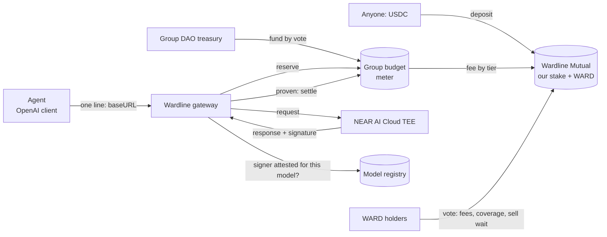

# Wardline

**A credit union for the AI economy, built on NEAR.**

AI agents now pay for model calls and vendor invoices on their own, and nothing checks what they're paying for. A provider can bill for a premium model and serve a cheap one. A look-alike vendor can intercept an invoice. A leaked key can drain a budget in seconds.

Wardline sits between the agent and the money. A payment clears only if

1. **the right model answered**, proven by the tamper-proof signature NEAR AI attaches to every response,
2. **the payee is real**, verified against the company's own domain, and
3. **it fits the budget**, enforced on chain by per-member and per-group caps.

Anything else is refused and refunded. The payee check adds a median **0.027 ms** to a payment (0.3 ms at p95) across 247 scam-test cases, so every single payment can be checked. In that test it stopped every scam payee with zero false alarms on real invoices, and an AI agent that paid 5 of 20 scams on its own paid none behind Wardline.

**The Mutual** backs it. Anyone deposits USDC and gets WARD (a NEP-141 token), a share of the pool. Every proven payment pays a fee into the pool, so WARD earns. If Wardline ever approves a bad payment, our own stake pays first, then WARD holders. WARD holders vote on fees, coverage and the sell wait.

**Groups** (teams, hacker houses, DAOs) fund shared AI budgets from their own Sputnik DAO treasury and give members allowances. A clean record moves a group up tiers (Bronze, Silver, Gold) with lower fees (2%, 1.5%, 1%).

**For developers** it's one line. Point your OpenAI client's base URL at Wardline.



## Try it (about 10 minutes, no keys)

Needs git, Node 20.19 or later and pnpm 12 (`corepack enable`). Use a POSIX shell (Git Bash on Windows). Everything runs offline against real NEAR AI traffic recorded in `fixtures/nearai`, with the contracts simulated. Nothing here calls NEAR AI or sends a transaction.

**1. Install and build**

```sh
pnpm install && pnpm build
```

**2. Start the offline providers and the API** (two terminals, leave both running)

```sh
# terminal A
pnpm demo:providers

# terminal B
export WARDLINE_API_PORT=8787
WARDLINE_AI_PROVIDER_URL=http://127.0.0.1:8791/replay/v1 WARDLINE_DEMO_METER_KEY=wk_demo_alice_key pnpm --filter @wardline/api start
```

You should see `Wardline API on http://127.0.0.1:8787`.

**3. Run the demos** (terminal C, run `export WARDLINE_API_PORT=8787` first)

| Run | What you should see |
| --- | --- |
| `pnpm demo:plugin` | One AI call through the official `openai` client. `Proof: verified`, then it pays and refunds the rest. Run it again and it's refused as a replay |
| `pnpm demo:swapped-model` | A provider claims DeepSeek but GLM answered. `MODEL_MISMATCH`, nothing paid |
| `pnpm demo:leaked-key` | 80 parallel requests from two leaked keys. Each stops at its allowance or the budget cap |
| `pnpm demo:mutual` | A deposit gets WARD. A payout hits our stake first, then WARD holders, then fees refill the pool |
| `pnpm demo:vote` | A WARD vote passes and lowers the Silver fee to 1.25% |
| `pnpm demo:tier` | A clean group moves from Bronze to Silver and its fee drops |
| `pnpm redteam:numbers` | Every scam payee stopped, 0 unsafe payments. An agent alone paid 5 of 20 scams, with Wardline 0 |

Check a look-alike payee:

```sh
curl -s http://127.0.0.1:8787/v1/check -H 'content-type: application/json' \
  -d '{"payee":"near:testnet:northw1nd.testnet","vendor":{"domain":"northwind.example"}}'
```

You should see `"verdict":"BLOCK"` with `"code":"LOOKALIKE_ACCOUNT"`.

**4. Open the app**

```sh
WARDLINE_DEV_API=http://127.0.0.1:8787 pnpm --filter @wardline/web dev
```

Open http://127.0.0.1:5173.

**5. Run the tests**

```sh
pnpm test
pnpm --filter @wardline/web exec playwright install chromium webkit
pnpm test:e2e
```

## See it live on NEAR testnet (read-only, no keys)

```sh
pnpm testnet:check
```

Then run the app on live testnet data.

```sh
# terminal A
WARDLINE_CHAIN_MODE=near WARDLINE_REGISTRY_MODE=near WARDLINE_API_PORT=8787 pnpm --filter @wardline/api start

# terminal B
WARDLINE_DATA=testnet WARDLINE_DEV_API=http://127.0.0.1:8787 pnpm --filter @wardline/web dev
```

Every row links to its transaction on testnet.nearblocks.io. Connect your own testnet wallet (Meteor, Intear, Nightly or Ledger) to deposit or vote for real.

The groups you'll see (Mission Street hacker house, Nightshade DAO, Hayes Valley house, Aurora Lab, Kelp Collective) are test communities the team runs on testnet. Their activity is scripted, but every transaction and every NEAR AI call is real, and `pnpm testnet:audit` re-checks each one against the chain.

Running the team's full stack (signing as test accounts, live AI calls) needs team keys. The full guide, every environment variable and the testnet numbers are in [docs/GUIDE.md](docs/GUIDE.md).

## Built on NEAR

- **WARD**, a NEP-141 token minted by the pool contract
- **Contracts** under `wardline-labs.testnet`. `meter` (budgets, allowances, tiers), `model-registry` (attested TEE signers), `pool` (the Mutual, WARD, claims, votes), `payee-registry` and `vault`
- **NEAR AI Cloud** signed inference. A call is paid only when its TEE signature names the model you asked for
- **Sputnik DAO v2** for group treasuries
- **NEAR Connect** wallets (Meteor, Intear, Nightly, Ledger)
- **Circle USDC on NEAR** for deposits, AI spend and fees

## Honest limits

- Testnet only.
- The Mutual is protocol-backed coverage, not insurance. WARD's price can fall.
- Token counts aren't signed. The charge uses the provider's reported usage, capped at what was reserved.
- We trust NEAR AI's attestation reports and don't re-verify the hardware quotes inside them.
- The payee check proves control of an account and its link to a domain, not legal ownership.

More in [docs/LIMITATIONS.md](docs/LIMITATIONS.md) and [docs/THREAT_MODEL.md](docs/THREAT_MODEL.md).

## Tracks

Social Money (lead), Agent Economy, AI Security & Defense, Privacy & Private AI, Real-World Money, Autonomous Business.

## Repo map

| Path | What |
| --- | --- |
| `apps/web` | The site |
| `services/api` | Gateway, the Mutual, groups, payee check |
| `contracts` | NEAR contracts |
| `packages/sdk` | `@wardline/sdk` for agents |
| `services/mcp` | MCP server for agents |
| `packages/x402-guard` | Checks each x402 offer's `payTo` before paying |
| `fixtures/nearai` | Real NEAR AI traffic, recorded once |
| `evidence/redteam` | Scam-test results |

## Disclosures

- No pre-hackathon code. The first commit is 2026-11-03.
- Most code was written with Claude Code, directed and reviewed by the team.
- Full library and license list in [docs/DISCLOSURES.md](docs/DISCLOSURES.md). Security reports go to [SECURITY.md](SECURITY.md).

## License

MIT. See [LICENSE](LICENSE).
